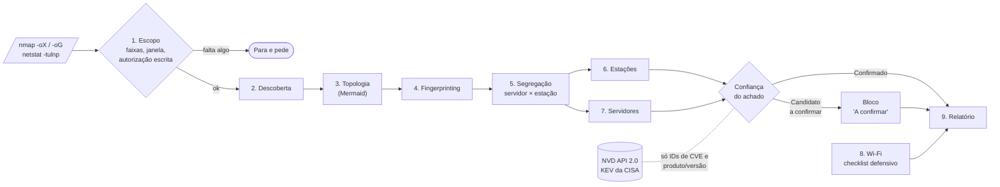
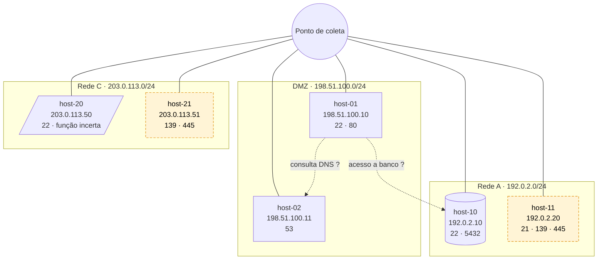

# redteam-claude-skills

[](redteam-recon/CHANGELOG.md)
[](LICENSE)
[](https://code.claude.com/docs/en/plugins)

**PT-BR** · [English](#english)

> **Triagem de reconhecimento para red team autorizado, dentro do Claude Code.**
> Você entrega a saída do nmap/netstat que já coletou; a skill devolve topologia, inventário, CVEs correlacionadas e um relatório técnico e executivo.
> Ela não varre, não explora e não chama de crítico o que não conseguiu confirmar.

## Plugins

| Plugin | Versão | O que faz |
|---|---|---|
| [`redteam-recon`](redteam-recon/) | 0.2.1 | Analisa saídas de nmap/netstat, mapeia a superfície de ataque, correlaciona CVEs (cheatsheet + NVD + KEV da CISA) e gera relatório. |

## Instalação

**Pelo marketplace** (dentro do Claude Code):

```text
/plugin marketplace add malhadajr/redteam-claude-skills
/plugin install redteam-recon@logospayload-redteam
```

No Claude Code 2.1.275 ou posterior, também em um passo: `/plugin install redteam-recon --marketplace malhadajr/redteam-claude-skills`.

Ou pelo terminal:

```bash
claude plugin marketplace add malhadajr/redteam-claude-skills
```

```bash
claude plugin install redteam-recon@logospayload-redteam
```

**Sem instalar** (para testar uma cópia local):

```bash
git clone https://github.com/malhadajr/redteam-claude-skills
```

```bash
claude --plugin-dir ./redteam-claude-skills/redteam-recon
```

Depois, invoque `/redteam-recon:redteam-recon-analyzer` ou descreva a tarefa ("triagem desta saída de nmap").

## Como funciona

A skill trabalha **sobre dados já coletados**. Nenhuma etapa toca o alvo.



| Etapa | O que faz |
|---|---|
| 1. Escopo | Portão obrigatório: faixas de IP, alvos, janela de testes e autorização formal por escrito. Sem isso, para. Hosts fora das faixas são descartados e registrados. |
| 2–4 | Hosts ativos, diagrama de topologia (gateways só com evidência) e fingerprinting de SO, portas, serviços e versões. |
| 5 | Classifica cada ativo como servidor de infraestrutura, servidor de aplicação ou estação; "incerto" quando a evidência é fraca. |
| 6–7 | Estações: SOs fora de suporte e serviços expostos. Servidores: web, banco, DNS, e-mail, AD/LDAP. Cada versão passa pela calibração antes de virar achado. |
| 8 | Wi-Fi: checklist somente defensivo. |
| 9 | Resumo executivo (só achados confirmados), achados F-NN, matriz de risco, inventário, fichas de CVE, remediação e lista do que ficou "não verificado". |

### Confirmado ou candidato

Banner não é prova. A versão que o `nmap -sV` informa para Samba e PostgreSQL é uma estimativa; um sufixo de distribuição (`3ubuntu13.20`) sugere correção por backport. Por isso todo achado tem um estado:

- **Confirmado:** versão de fonte confiável e coerente com o SO, dentro da faixa afetada, sem indício de backport.
- **Candidato a confirmar:** versão heurística, contraditória ou sujeita a backport. **Nunca** recebe Crítico nem Alto, e fica fora do resumo executivo.

### CVEs com rastreabilidade

O [cheatsheet](redteam-recon/skills/redteam-recon-analyzer/references/common-cve-cheatsheet.md) é uma base clássica (2011–2024), com data de última verificação. Durante a análise, a skill o complementa com a **NVD API 2.0** e o **catálogo KEV da CISA**. Só IDs de CVE e produto/versão saem da máquina; nunca IPs, hostnames ou trechos da coleta. Sem rede, o que não está no cheatsheet vira "não verificado". Itens marcados com † no cheatsheet ainda não foram confirmados em fonte primária.

## Exemplo real (laboratório, anonimizado)

Laboratório de 6 hosts Ubuntu 24.04 em *network namespaces*, sem rota externa, com pacotes reais e atualizados. IPs renumerados para os blocos de documentação (RFC 5737); a skill não teve acesso ao inventário de pacotes (o "gabarito").

**Entrada** (reconstituída no formato `-oG` a partir da coleta, só com os campos relevantes):

```text
Host: 192.0.2.10 (host-10)    Ports: 22/open/tcp//ssh//OpenSSH 9.6p1/, 5432/open/tcp//postgresql//PostgreSQL DB 9.6.0 or later/
Host: 192.0.2.20 (host-11)    Ports: 21/open/tcp//ftp//vsftpd/, 139/open/tcp//netbios-ssn//Samba smbd 4.6.2/, 445/open/tcp//netbios-ssn//Samba smbd 4.6.2/
Host: 203.0.113.51 (host-21)  Ports: 139/open/tcp//netbios-ssn//Samba smbd 4.6.2/, 445/open/tcp//netbios-ssn//Samba smbd 4.6.2/
```

**Saída** (excerto da tabela de achados da v0.2.1):

| ID | Ativo | Achado | Estado | Severidade | CVE |
|---|---|---|---|---|---|
| F-01 | host-10 | PostgreSQL escutando no IP da rede | Confirmado | Baixa | — |
| F-02 | host-11 | FTP em texto claro | Confirmado | Baixa | — |
| F-03 | host-11 | Samba "4.6.2" na faixa afetada | Candidato: banner inconsistente com o SO (4.6.2 não existe no Ubuntu 24.04) | Candidato (CVSS 9.8 se confirmado) | [CVE-2017-7494](https://nvd.nist.gov/vuln/detail/CVE-2017-7494) |
| F-04 | host-21 | Idem | Candidato: idem | Candidato (CVSS 9.8 se confirmado) | [CVE-2017-7494](https://nvd.nist.gov/vuln/detail/CVE-2017-7494) |

Gabarito: o Samba instalado era o **4.19.5**, fora da faixa afetada. A v0.2.0 tinha marcado F-03 e F-04 como **Crítico** e aberto o resumo executivo com eles; a v0.2.1 os manteve como candidatos, e a postura geral caiu de "Alta" para "Baixa".

**Topologia** (excerto do diagrama gerado; sem traceroute na coleta, nenhum gateway foi inventado):



## Status

| | |
|---|---|
| Validador | `claude plugin validate` passa. |
| Testado | Laboratório de 6 hosts Linux (Ubuntu 24.04): OpenSSH, Apache, BIND, PostgreSQL, vsftpd e Samba. Serviços e portas corretos nos 6 hosts; backport do OpenSSH reconhecido. |
| Corrigido na 0.2.1 | Falso positivo crítico em Samba (nmap disse 4.6.2; o real era 4.19.5). Ver [CHANGELOG](redteam-recon/CHANGELOG.md). |
| **Ainda sem prova** | Hosts **Windows** e versões **realmente vulneráveis** (o laboratório só tinha pacotes corrigidos). Engajamentos reais. |
| Limite conhecido | O portão de escopo aceita a autorização que o usuário declara; ele depende da honestidade de quem usa. |

## Uso responsável

- Use **apenas** com autorização formal por escrito do dono dos sistemas, dentro do escopo e da janela acordados.
- A skill **não** gera payloads, exploits nem instruções de exploração, **não** testa credenciais padrão e **não** valida vulnerabilidades de forma ativa.
- Dados reais de coleta e relatórios ficam **fora** do repositório. O [`.gitignore`](.gitignore) bloqueia os formatos mais comuns, mas não substitui atenção.
- Falhas de segurança no próprio plugin: ver [SECURITY.md](SECURITY.md).

Os autores não se responsabilizam por uso indevido.

## Licença

MIT. Autor: LogosPayload.

---

<a id="english"></a>

<details>
<summary><strong>English</strong></summary>

## redteam-claude-skills

> **Reconnaissance triage for authorized red teams, inside Claude Code.**
> Hand it the nmap/netstat output you already collected; the skill returns topology, asset inventory, correlated CVEs, and a technical and executive report.
> It does not scan, does not exploit, and does not call critical what it could not confirm.

### Install

Inside Claude Code:

```text
/plugin marketplace add malhadajr/redteam-claude-skills
/plugin install redteam-recon@logospayload-redteam
```

Or try a local copy without installing:

```bash
git clone https://github.com/malhadajr/redteam-claude-skills
```

```bash
claude --plugin-dir ./redteam-claude-skills/redteam-recon
```

Then invoke `/redteam-recon:redteam-recon-analyzer` or describe the task ("triage this nmap output"). The skill instructions and report template are written in Portuguese.

### How it works

Nine steps, all on data you provide (see the diagram above): a mandatory **scope gate** (IP ranges, targets, testing window, written authorization; without them it stops), host discovery, Mermaid topology, fingerprinting, server/workstation segregation, workstation and server findings, a defensive-only Wi-Fi checklist, and the report.

Every finding has a state. **Confirmed**: version from a reliable source, consistent with the OS, in the affected range, no sign of a backport. **Candidate**: heuristic, contradictory, or possibly backported version; it is **never** rated Critical or High and stays out of the executive summary.

CVEs come from a verified baseline [cheatsheet](redteam-recon/skills/redteam-recon-analyzer/references/common-cve-cheatsheet.md) plus live lookups to the **NVD API 2.0** and the **CISA KEV catalog**. Only CVE IDs and product/version strings leave the machine. Offline, anything outside the cheatsheet is marked "not verified". Items marked † in the cheatsheet are not yet confirmed against a primary source.

### Real example

The example above comes from a 6-host Ubuntu 24.04 lab (network namespaces, no external route, real up-to-date packages, IPs renumbered to RFC 5737). nmap reported Samba "4.6.2"; the installed version was 4.19.5. Version 0.2.0 flagged it Critical; 0.2.1 keeps it as a **candidate** (inconsistent with the OS), and the overall posture dropped from "High" to "Low".

### Status

Passes `claude plugin validate`. Tested on a 6-host Linux lab. **Not yet proven** on Windows hosts, on genuinely vulnerable versions, or on real engagements. The scope gate trusts the authorization the user declares.

### Responsible use

Use **only** with formal written authorization from the system owner. No payloads, exploits, exploitation instructions, or default-credential testing. Keep real collection data and reports out of the repository. Security issues in the plugin itself: see [SECURITY.md](SECURITY.md). The authors are not responsible for misuse.

### License

MIT. Author: LogosPayload.

</details>
