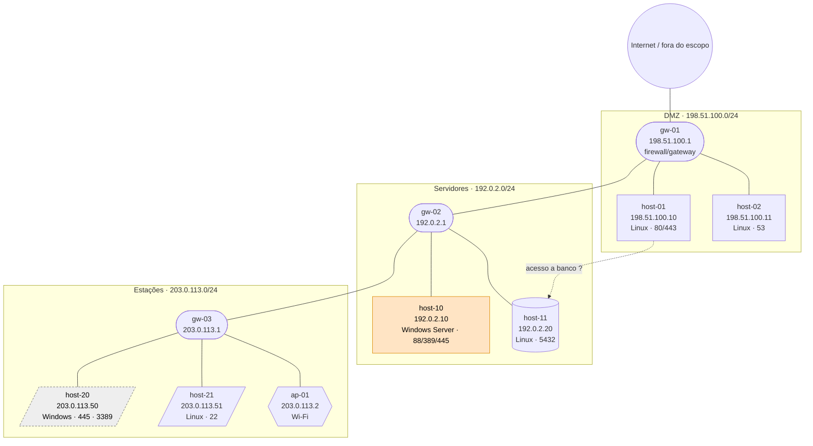

# Template: topologia de rede (Mermaid)

> Use somente dados **anonimizados** (IPs RFC 5737, `host-NN`, `CLIENTE-A`). Marque inferências com linha tracejada (`-.->`) e `?` no rótulo.

## Convenções

- Um `subgraph` por sub-rede; o rótulo traz o CIDR.
- Forma do nó: `([ ])` gateway/roteador/firewall, `[( )]` banco de dados, `[ ]` servidor, `[/ /]` estação, `{{ }}` ponto de acesso Wi-Fi.
- Rótulo do nó: `nome IP SO · portas-chave`.
- Classes: `crit` (achado CVSS ≥ 9.0), `high` (7.0–8.9), `eol` (SO fora de suporte), `unk` (não classificado).

## Diagrama

## Preenchimento

1. Uma linha por host ativo; agrupar por sub-rede inferida do CIDR informado em escopo.
2. Aplicar `class <id> <classe>` conforme a pior severidade verificada do host.
3. Ligações sem evidência direta (rota, ARP, traceroute, conexão em `netstat`) usam `-.->` e rótulo com `?`.
4. Adicionar abaixo do diagrama uma **legenda de evidências**: de onde veio cada gateway e cada ligação.

| Elemento | Evidência | Confiança |
|---|---|---|
| gw-01 | _ex.: saída de traceroute / tabela de rotas_ | alta / média / baixa |
